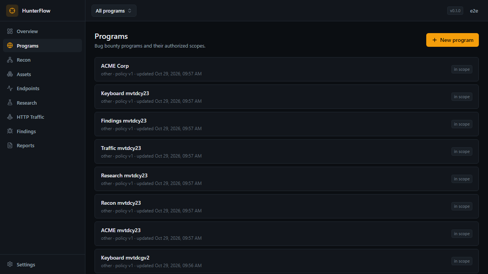
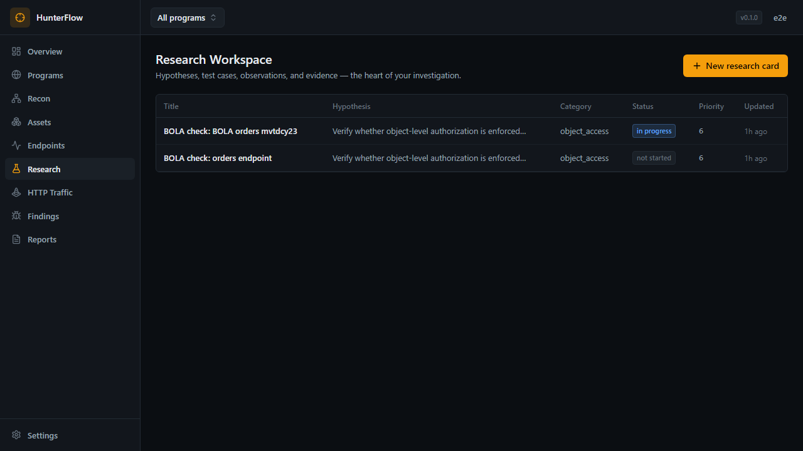

# HunterFlow

**From Recon to Research. One Intelligent Workspace.**

HunterFlow is a self-hosted, open-source research workspace for authorized bug bounty hunters and web/API penetration testers. It connects reconnaissance to structured investigation and evidence-backed reporting — while making **authorization and scope enforcement** a built-in property of every automated step.

> HunterFlow is a research assistant and workflow system. It is **not** an autonomous exploitation platform.

---

## 1. What problem does it solve?

Bug bounty research is fragmented: recon output lives in per-tool file trees, your hypotheses and rejections live in notebooks, scope rules live in memory, and reports are assembled by hand. Existing tools each solve a slice — `subfinder`/`httpx`/`katana`/`nuclei` (discovery), Burp/Caido (traffic), DefectDojo/Faraday (team vulnerability management) — but none connect **authorization-aware discovery** to **hypothesis-driven research** and **evidence-backed reporting** in one workspace.

## 2. Key features

- **Program & scope management** — versioned scope rules (exact/wildcard/CIDR/path/method), exclusion precedence, and a scope-preview validator.
- **Authorization-aware recon** — every active outbound operation passes through the program's effective policy; out-of-scope targets are blocked (including redirects), and ambiguous targets require explicit confirmation.
- **Recon orchestration** — managed subprocess adapters for `subfinder`, `httpx`, `katana`, and curated `nuclei` templates, with scan profiles, job lifecycle, cancellation, and execution history.
- **Asset & endpoint intelligence** — normalized, deduplicated inventory with provenance, scope status, tech, and endpoint categorization (informational, never a vulnerability claim).
- **Research workspace** — hypothesis cards with state machines, checklists, templates, and evidence linking.
- **HTTP traffic import & comparison** — HAR import with secret redaction, side-by-side diffing with dynamic-value normalization, and explicit "review required" notices (a status-code difference alone never implies a vulnerability).
- **Findings & evidence** — structured lifecycle with duplicate detection, human-only verification, SHA-256-integrity evidence storage.
- **Explainable prioritization** — deterministic, rule-based scoring with visible factors (a score is a lead indicator, not a vulnerability claim).
- **Reports** — Markdown/JSON/HTML export with an always-present verification banner.
- **Self-hosted, no paid dependencies** — runs entirely locally with Docker Compose.

## 3. Architecture overview

```
Browser ──► web (Next.js) ──► api (FastAPI) ──┬─► PostgreSQL
                                              ├─► Redis
                                              └─► worker (Dramatiq + pinned tools)
```

A **modular monolith**: one backend codebase runs as an API process and an isolated worker process. Tool binaries are pinned and bundled in the worker image (verified SHA-256). The scope policy engine (`domain/scope`) is the single authority consulted before every active network operation. Full details in [`specs/architecture/`](specs/architecture/system-architecture.md) and the [ADRs](specs/architecture/adr/).

## 4. Screenshots

Captured from the running application.

| | |
|---|---|
|  |  |
|  |  |
|  |  |

More: `docs/screenshots/` (endpoints, recon).

## 5. Installation

Requires Docker and Docker Compose.

```bash
git clone https://github.com/your-org/hunterflow.git
cd hunterflow
cp .env.example .env
# edit .env and set HF_SECRET_KEY to a long random value
docker compose up -d
```

Open http://localhost:3000 — the first-run flow creates your account. See [docs/installation.md](docs/installation.md) for details.

## 6. Quick start

1. Create a **program** and add its **scope rules** (e.g. `*.example.com` allow).
2. Use the **scope preview** to confirm the policy behaves as expected, then **publish a policy version**.
3. Run a **passive discovery** scan from Recon. Results become **assets**.
4. Open an **endpoint**, create a **research card** from a template (BOLA/IDOR, authn bypass…), and record observations.
5. **Import a HAR** (or add manual transactions), then **compare** two authorized-account responses.
6. Promote verified work to a **finding**, attach **evidence**, and **generate a report**.

## 7. Example workflow

See [docs/user-guide.md](docs/user-guide.md) for a full walkthrough of the F1–F7 journeys.

## 8. Supported integrations

| Tool | Role | License |
|---|---|---|
| subfinder | passive subdomain discovery | MIT |
| httpx | HTTP probing/fingerprinting | MIT |
| katana | crawling / endpoint extraction | MIT |
| nuclei | curated template checks (explicit selection only) | MIT |

Traffic import via **HAR 1.2** (Burp Suite / Caido export). Pinned versions + checksums are recorded in [`backend/integrations/tools.lock`](backend/integrations/tools.lock).

## 9. Security & authorization statement

- Scope enforcement **precedes** every active network operation; out-of-scope redirects are not followed; discovered third-party assets default to out-of-scope.
- Human-in-the-loop: findings are never auto-verified; no autonomous exploitation; no automatic submission.
- Local-only data, zero telemetry; evidence is never statically served and is stored with SHA-256 integrity checks.
- See [`SECURITY.md`](SECURITY.md) and [`specs/architecture/security.md`](specs/architecture/security.md) for the threat model and **residual risks**.

**HunterFlow is for authorized testing only. Never use it against systems without explicit authorization.**

## 10. Roadmap

- **v0.2 — Monitoring:** scheduled scans, snapshots, change detection, opt-in notifications.
- **v0.3 — Local AI:** optional Ollama-backed research assistant (off by default, deterministic fallback).
- **v0.4 — Collaboration:** multi-user support.

See [`specs/product-requirements.md`](specs/product-requirements.md) §10.

## 11. Development

```bash
# Backend (Python 3.12 + uv)
cd backend && uv sync && uv run pytest

# Frontend (Node 20)
cd web && npm install && npm run dev

# E2E (requires running stack)
cd web && npx playwright test e2e
```

Full instructions in [docs/development.md](docs/development.md).

## 12. Contributing

Contributions welcome — read [CONTRIBUTING.md](CONTRIBUTING.md) and the [Code of Conduct](CODE_OF_CONDUCT.md). Behavior changes must respect the project [constitution](specs/constitution.md) and be covered by tests.

## 13. Known limitations

- Single-user (v0.1.0); no multi-tenancy.
- Recon workers require the Docker deployment (Redis broker); local dev without Docker uses synchronous dry-run only.
- Per-request scope control inside third-party tools is limited (documented residual risk); full mitigation would require a proxy gateway (deferred).
- PDF report export and continuous traffic interception are post-MVP.
- See [docs/known-issues.md](docs/known-issues.md).

## 14. License

[MIT](LICENSE). Vendored `nuclei` templates (if added) are MIT with attribution per [`backend/integrations/tools.lock`](backend/integrations/tools.lock).
