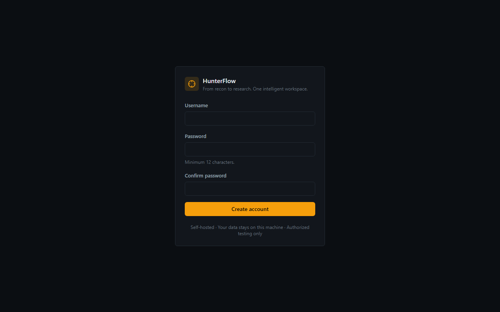
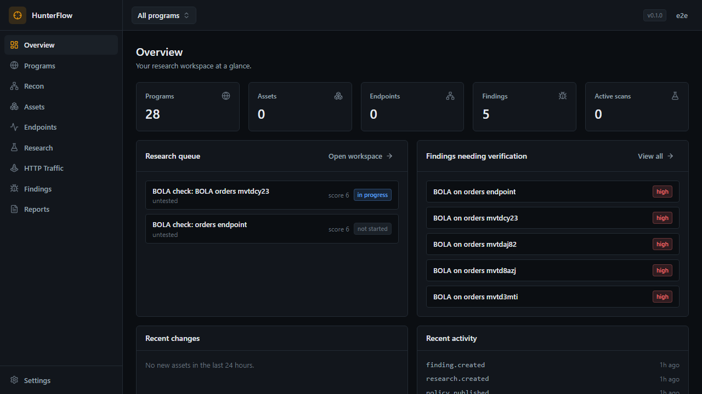
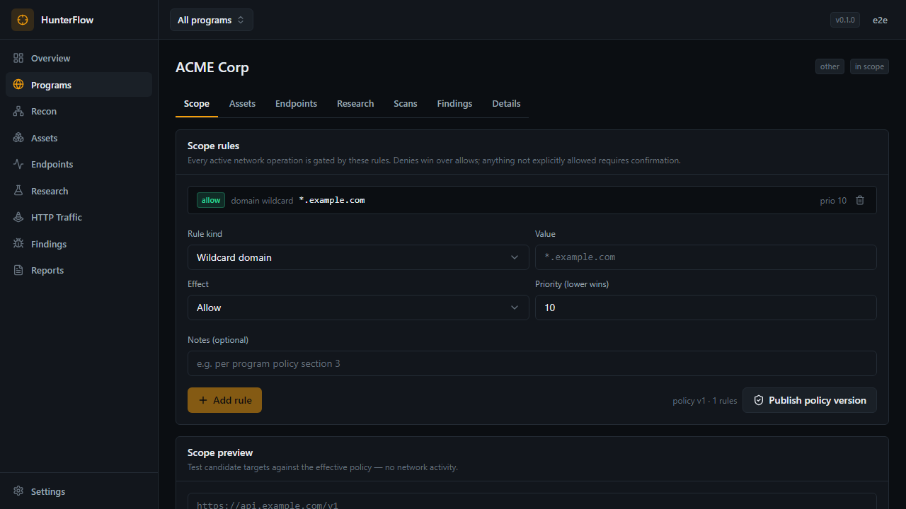
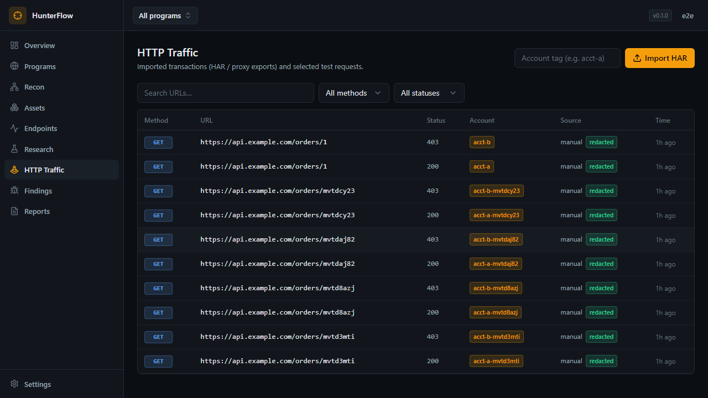
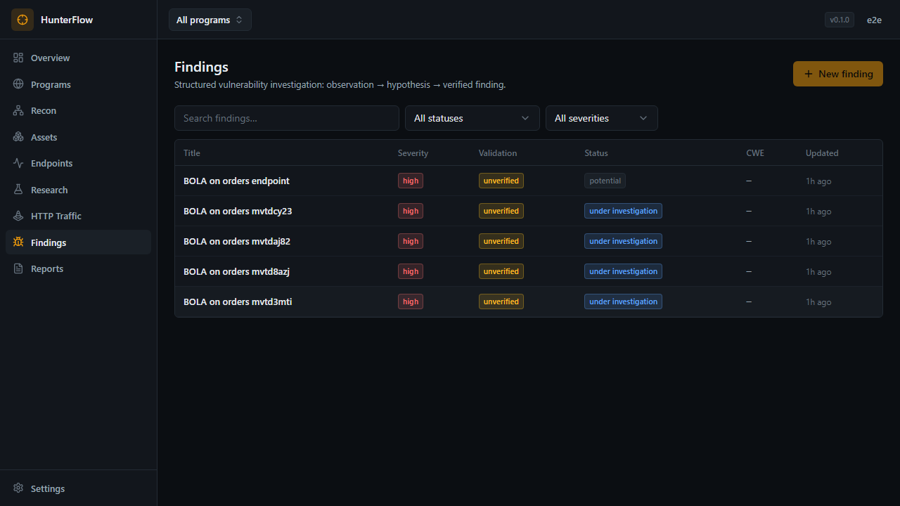
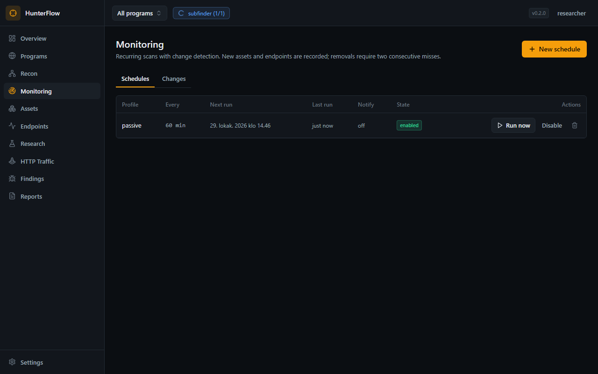
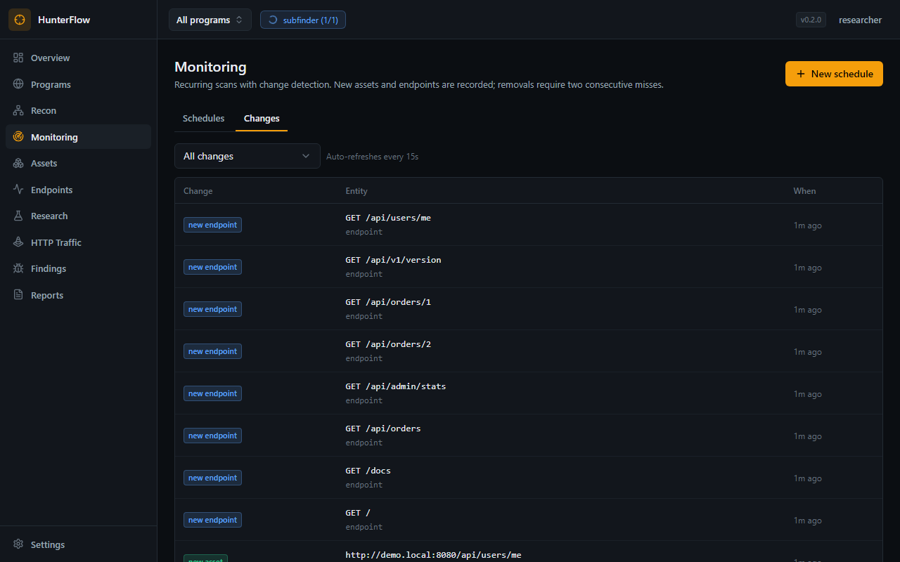

# HunterFlow

A self-hosted workspace for authorized bug bounty research. It keeps your recon output,
your hypotheses, the traffic you compare, and the evidence behind each finding in one
place, and it refuses to touch anything that is not explicitly in scope.

HunterFlow is not a scanner and not an exploitation framework. It orchestrates existing
tools (subfinder, dnsx, httpx, gau, katana, nuclei), stores what they find, and gives you a place to
think about it.

Status: v0.2 (research workspace + monitoring), single-user, early. Read the limitations
before you rely on it.

---

## What it does

- **Scope-first.** Every program has versioned scope rules. Every active request is
  checked against the effective policy first. Wildcards do not authorize the apex or third
  parties, deny rules win, and anything ambiguous is blocked until you confirm it.
- **Recon as a job.** Scans run in a worker with progress, cancellation, timeouts and a
  record of the exact tool version and arguments used. Passive, light, inventory, passive-URL, and curated-template profiles.
- **An inventory instead of file trees.** Assets and endpoints are normalized and
  deduplicated, keep their provenance, and carry a scope status.
- **Research cards.** A hypothesis, methodology, accounts needed, checklist, notes, and
  a status that only moves through legal transitions.
- **Traffic comparison.** Import a HAR, compare two authorized-account responses side by
  side. Timestamps and tokens are masked. A status-code difference alone raises a review
  notice, never a finding.
- **Findings and evidence.** Separate states for "scanner said something", "I am testing
  this", and "a human verified this". Evidence is hashed and only served through an
  authenticated endpoint.
- **Reports.** Markdown, JSON, HTML. Every report states whether the finding was verified.
  Nothing is submitted anywhere automatically.
- **Continuous monitoring.** Scheduled scans per program with change detection: new assets,
  new endpoints, new JavaScript files, HTTP status and technology changes, and removals only
  after two consecutive misses. Optional webhook notifications (Discord/Slack) and optional
  auto-created draft research cards for new endpoints and JS files, both opt-in per schedule.
- **PDF reports.** Findings export to Markdown, JSON, HTML and PDF, always with the
  verification banner.
- **Team workspace.** Multiple accounts sharing one workspace; the first account is the
  administrator and can create, promote, deactivate and reset users. Optional open
  registration (`HF_ALLOW_REGISTRATION`).
- **Optional AI assistant.** Off by default. Works with any OpenAI-compatible endpoint
  (local Ollama by default), only reads the page you open, has no tool access, and its
  output is labeled as advisory.
- **Optional screenshots.** Build the worker with `HF_WITH_SCREENSHOTS=1` and run the
  Screenshots profile to capture pages; images are stored on the data volume and served
  through an authenticated endpoint.

## Requirements

- Docker and Docker Compose
- About 2 GB of disk for the images (the worker image includes the recon binaries)

No accounts, subscriptions or paid APIs are involved.

## Running it

```bash
git clone https://github.com/cyberx801/hunterflow.git
cd hunterflow
cp .env.example .env
```

Open `.env` and set `HF_SECRET_KEY` to a long random value:

```bash
python -c "import secrets; print(secrets.token_urlsafe(48))"
```

Then:

```bash
docker compose up -d
```

Open http://localhost:3000.

### The first account

HunterFlow is single-user. On the very first launch there are no accounts, so the login page
shows a **Create account** form instead of a sign-in form:



1. Pick a username.
2. Pick a password of at least 12 characters.
3. Submit. You are logged in and land on the Overview page.

After that account exists, registration is closed; the same page is a normal sign-in form.

If you would rather not create the account in the browser, set these before starting the
stack and the account is created on boot:

```env
HF_BOOTSTRAP_USERNAME=admin
HF_BOOTSTRAP_PASSWORD=a-long-password-here
```

### A first run through the app

1. **Programs → New program.** Name it, open the Scope tab.
2. Add a rule like `*.example.com` with effect *allow*. Use **Scope preview** with a target
   inside and one outside the scope to see the decision for each. Then **Publish policy
   version**. Nothing can be scanned until the policy has at least one rule.
3. **Recon → New scan.** Choose *Passive Discovery*, optionally run a dry run first, and
   start it. The job shows up in the list; open it for the tool arguments and output.
4. **Assets / Endpoints** now have data. Open an endpoint and create a research card from a
   template.
5. **HTTP Traffic.** Import a HAR exported from Burp or Caido (tag it with an account
   name), select two transactions, and compare them.
6. **Findings.** Record a finding, attach evidence, and generate a Markdown report. Marking
   it verified requires an explicit confirmation.

To try a real scan without touching any third-party system, follow
[docs/local-demo.md](docs/local-demo.md): it scans the synthetic demo app in this repo.

To run it continuously on a server (scheduled scans, change detection, webhook alerts), see
[docs/server-deployment.md](docs/server-deployment.md) and the
[monitoring playbook](docs/monitoring-playbook.md).

## Screens

Captured from the running application.

| | |
|---|---|
|  |  |
|  |  |
|  |  |
|  |  |

More in `docs/screenshots/` (programs, endpoints, recon, first-run account).

## How it works

```
Browser  ->  web (Next.js)  ->  api (FastAPI)  ->  PostgreSQL
                                             ->  Redis
                                             ->  worker (Dramatiq + pinned tools)
                                             ->  scheduler (due scheduled scans)
```

The API and the worker are the same codebase. Long jobs never run inside an HTTP request.
The scope engine is a pure function; it is the only thing that decides whether a host may
be contacted, and it is covered by its own tests. Design notes and the decision records are
in [`specs/`](specs/).

## Project layout

```
backend/    FastAPI app, domain logic, worker, tool adapters, tests
web/        Next.js frontend
demo/       synthetic intentionally-flawed app used only by local tests
specs/      product, architecture, design, and implementation specifications
docs/       installation, development, user guide, benchmarks
```

## Development

```bash
# backend
cd backend
uv sync --all-groups
uv run alembic upgrade head
uv run uvicorn app.main:app --reload --port 8000
uv run pytest

# frontend
cd web
npm install
npm run dev
npm run typecheck
npm run build

# end to end (needs the two dev servers above running)
cd web && npx playwright install chromium && npx playwright test e2e
```

Real scans need Redis and a worker process; the recommended way is `docker compose`.
Without them the app still runs and dry runs work.

More detail in [`docs/development.md`](docs/development.md) and
[`docs/installation.md`](docs/installation.md).

## Tests

```
backend: 174 passed (unit, integration, security)
e2e:     6 passed (Playwright, critical journeys)
lint:    ruff clean, tsc clean
```

The stack was also exercised end to end with Docker Compose (PostgreSQL, Redis, worker,
scheduler, synthetic demo target): a real `web_inventory` scan ran subfinder, dnsx, httpx, gau and
katana against `demo.local`, produced assets and endpoints, recorded change events, and a
schedule fired automatically from the scheduler.

The security suite attacks the real controls: scope bypasses, host tricks, CSRF, injection,
redaction, and evidence isolation. See [`specs/testing-strategy.md`](specs/testing-strategy.md).

## Security notes

- Use it only against systems you are authorized to test.
- Scope enforcement happens before the request, but third-party tools offer limited
  per-request control. The residual risks are written down in
  [`specs/architecture/security.md`](specs/architecture/security.md).
- Run it locally. Do not expose it to the internet without TLS and an auth proxy.
- Report vulnerabilities privately as described in [`SECURITY.md`](SECURITY.md).

## Limitations

- Single user, no teams or roles yet.
- Removal detection is heuristic (two consecutive misses); treat "removed" as a prompt to
  re-check, not as fact.
- No continuous proxy capture.
- See [`docs/known-issues.md`](docs/known-issues.md) for the current list.

## Roadmap

- v0.1 - research workspace (done).
- v0.2 - monitoring: schedules, change detection, webhook notifications (done).
- v0.2.1 - dnsx and gau adapters, passive URL discovery profile (done).
- v0.3 - PDF reports, optional AI assistant, team workspace with admin user management (done).
- v0.4 - richer change detection (status/tech changes, new JS files) and optional screenshots (done).
- v0.5 - auto draft research cards from monitoring changes; web_crawl profile (done).
- Next - continuous proxy capture, more integrations.

## License

MIT. See [`LICENSE`](LICENSE).


